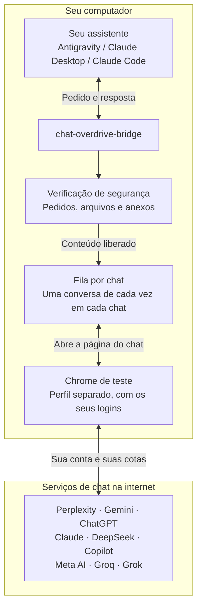
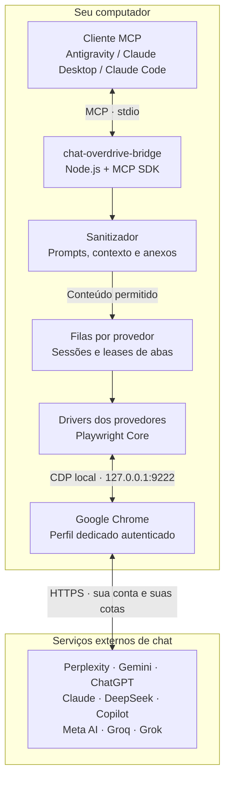
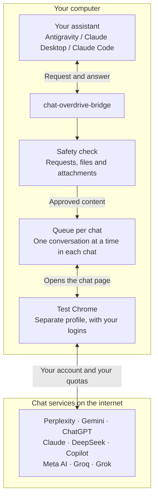
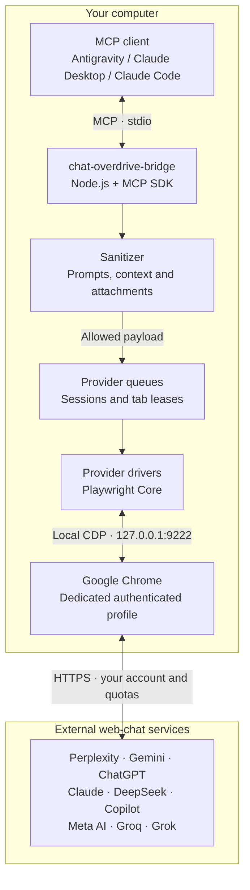

<div align="center">

# ⚡ chat-overdrive-bridge

### Seus assistentes de IA. Seus chats web. Uma ponte local.
### Your AI assistants. Your web chats. One local bridge.

Use o Gemini, o ChatGPT, o Claude, o Perplexity, o DeepSeek, o Copilot, o Meta AI, o Groq e o Grok direto do seu assistente (como o Antigravity), com as suas próprias contas: sem extensão de navegador e sem pagar por chave de API.

Use Gemini, ChatGPT, Claude, Perplexity, DeepSeek, Copilot, Meta AI, Groq and Grok straight from your assistant (such as Antigravity), with your own accounts: no browser extension and no pay-per-use API key.

<p align="center">
  <a href="https://github.com/samucamg/chat-overdrive-bridge">
    
  </a>
  <a href="#pt-estado">
    
  </a>
  <a href="LICENSE">
    
  </a>
</p>

<p align="center">
  <a href="#pt-chats">
    
  </a>
  <a href="#pt-chats">
    
  </a>
  <a href="#pt-instalacao">
    
  </a>
  <a href="#pt-chats">
    
  </a>
</p>

<p align="center">
  <a href="#portugues">
    
    
  </a>
  &nbsp;&nbsp;
  <a href="#english">
    
    
  </a>
</p>

<p align="center">
  <a href="#pt-instalacao">Instalação</a> ·
  <a href="#pt-uso">Como pedir</a> ·
  <a href="#pt-seguranca">Segurança</a> ·
  <a href="#pt-problemas">Problemas</a> ·
  <a href="SECURITY.md">Política de segurança</a> ·
  <a href="https://github.com/samucamg/chat-overdrive-bridge/issues">Relatar problema</a>
</p>

</div>

> [!IMPORTANT]
> Este projeto usa as suas próprias contas de chat e as cotas que cada serviço já oferece. Ele não desbloqueia recursos pagos, não contorna limites e não transforma uma assinatura em API oficial.
>
> EN: this project uses your own web-chat accounts and their existing quotas. It does not unlock paid features, bypass usage limits, or turn a subscription into an official API.

---

<a id="portugues"></a>

#  Português (Brasil)

<p align="center">
  <a href="#pt-visao-geral">O que é</a> ·
  <a href="#pt-chats">Chats</a> ·
  <a href="#pt-instalacao">Instalação</a> ·
  <a href="#pt-uso">Como pedir</a> ·
  <a href="#pt-seguranca">Segurança</a> ·
  <a href="#pt-problemas">Problemas</a> ·
  <a href="#pt-programadores">Para programadores</a> ·
  <a href="#english">English</a>
</p>

<a id="pt-visao-geral"></a>

## ✨ O que é e para que serve

Você já tem conta no Gemini, no ChatGPT, no Claude, no Perplexity, no DeepSeek, no Copilot, no Meta AI, no Groq ou no Grok? O `chat-overdrive-bridge` deixa o seu assistente (como o **Antigravity**) conversar com esses chats pelo seu navegador Chrome. A resposta aparece no próprio chat do seu assistente.

Sem copiar e colar entre janelas. Sem trocar de modelo no assistente. Sem extensão de navegador. Sem pagar à parte pelo uso.

> Use o Gemini web para revisar este erro e sugerir uma correção.

### Por que usar?

- ⚡ **Use a cota do seu plano de chat.** Modelos avançados, como o Gemini, funcionam com a cota da sua conta no site, sem pagar por chave de API.
- 🆓 **Chats gratuitos valem.** O DeepSeek, o Groq (iniciando em Qwen 3.8 27B) e o Grok (modos Fast e Build) na web são gratuitos e funcionam igual aos outros.
- 💻 **Planos como o ChatGPT Go também servem para programar**, em vez de depender só da cota do seu assistente de código. As regras de cota são de cada serviço e podem mudar.
- 🔌 **Fique no Antigravity.** Sem trocar de modelo nem de janela: basta o Chrome de teste aberto, com os chats logados.
- 🧭 **Peça uma segunda opinião.** Compare as respostas de vários chats com uma única pergunta.
- 💬 **Continue conversas.** Peça para seguir na mesma conversa do Gemini, do ChatGPT e dos outros.
- 🛡️ **Seguro por padrão.** O projeto confere o que você vai enviar e recusa senhas, chaves e dados pessoais.
- 🖥️ **Tudo no seu computador.** Não existe servidor na internet entre você e o chat.

> [!NOTE]
> Rodar no seu computador não significa funcionar sem internet. O que você envia a um chat é processado por esse serviço e continua sujeito aos termos, à política de privacidade, aos limites e às regras de assinatura dele.
>
> Os custos do seu assistente ou da sua ferramenta de programação são separados.

---

<a id="pt-chats"></a>

## 🌐 Chats que funcionam

| Chat | Site | Como pedir |
| :--- | :--- | :--- |
| Perplexity | [perplexity.ai](https://www.perplexity.ai/) | “Pergunte ao Perplexity…” |
| Google Gemini | [gemini.google.com](https://gemini.google.com/) | “Use o Gemini web…” |
| ChatGPT (inclusive o Go) | [chatgpt.com](https://chatgpt.com/) | “Pergunte ao ChatGPT…” |
| Claude | [claude.ai](https://claude.ai/) | “Consulte o Claude web…” |
| DeepSeek (gratuito) | [chat.deepseek.com](https://chat.deepseek.com/) | “Peça ao DeepSeek…” |
| Microsoft Copilot | [copilot.cloud.microsoft](https://copilot.cloud.microsoft/) | “Pergunte ao Copilot…” |
| Meta AI | [meta.ai](https://www.meta.ai/) | “Pergunte ao Meta AI…” |
| Groq | [chat.groq.com](https://chat.groq.com/?model=qwen/qwen3.8-27b) | “Pergunte ao Groq…” (inicia no Qwen 3.8 27B evitando o árabe padrão; troca automática de modelo se bater 429) |
| Grok (xAI) | [grok.com](https://grok.com/) | “Pergunte ao Grok…” (opera nos modos gratuitos Fast e Build, com busca web e citações) |

Os nove chats foram testados pelo autor no Windows 10, com o Chrome e o Antigravity.

No ChatGPT Go, no Plus e nos demais planos, os modelos, os recursos e as cotas dependem da sua conta no site. O projeto não concede acesso adicional a modelos.

### Assistentes e sistemas

| Item | Situação atual |
| :--- | :--- |
| Google Antigravity IDE | Testado pelo autor no Windows 10 (suporta também execução com extensão/agente Claude Code dentro da Antigravity IDE) |
| Claude Code (CLI e extensão em IDEs como Antigravity / VS Code) | Testado pelo autor no Windows 10 (`claude mcp add`) |
| OpenAI Codex (CLI / Desktop) | Compatível e testado pelo autor no Windows 10 (`config.toml` → `[mcp_servers.chat-overdrive-bridge]`) |
| DeepSeek Harness (DSH) | Compatível e testado pelo autor no Windows 10 (`@deepseek-ai/dsh-mcp-client` em `cordis.patch.yml`) |
| Claude Desktop | Registro automático no instalador (`claude_desktop_config.json`) |
| Outras IDEs e clientes MCP (`stdio`) (Cursor, Windsurf, Cline, Continue, Zed) | Compatíveis via configuração padrão (`command: "node"` + `args: [".../src/server.mjs"]`) |
| Windows 10 | Testado pelo autor |
| Windows 11 | Incluído nas instruções de instalação; compatível |
| macOS e Linux | Instruções manuais disponíveis; ainda não testados pelo autor |

> [!IMPORTANT]
> “Previsto” e “testado” são coisas diferentes. Trate o que ainda não foi testado como experimental.

---

## ⚖️ Ponte web ou API oficial?

| Aspecto | chat-overdrive-bridge | API oficial do serviço |
| :--- | :--- | :--- |
| Acesso | A sua conta logada no navegador | Credenciais da API |
| Limites de uso | Regras da sua conta e do seu plano no site | Regras de cota e cobrança da API |
| Como funciona | Usa a página do chat no seu Chrome | Pedidos feitos por programa à API |
| Mudanças no serviço | Uma atualização do site pode quebrar o funcionamento | Regida pelo contrato da API |
| Escolha do modelo | Usa o modelo que o site está mostrando; a troca automática não existe | Depende da API |
| Indicado para | Uso pessoal e supervisionado, e experimentação | Aplicações que precisam de uma interface documentada |

A ponte complementa as APIs oficiais; não é um substituto delas.

---

## 🏗️ Como funciona



Chats diferentes podem responder ao mesmo tempo. No mesmo chat, os pedidos vão um de cada vez. Se o site pedir uma verificação (como "sou humano"), a ponte para e espera você resolver.

---

<a id="pt-instalacao"></a>

## 🚀 Instalação

### Passo 1 — O que você precisa

- Windows 10 ou 11.
- Google Chrome.
- As suas contas nos chats que quiser usar.

O instalador confere o resto e oferece instalar o que faltar (como o Node.js), sempre pedindo a sua permissão.

### Passo 2 — Baixe o projeto

Nesta página do GitHub, clique em **Code** e depois em **Download ZIP**. Extraia numa pasta permanente, por exemplo:

```text
C:\chat-overdrive-bridge
```

Se preferir usar o Git:

```bash
git clone https://github.com/samucamg/chat-overdrive-bridge.git
```

> [!IMPORTANT]
> Não apague nem mova a pasta depois da instalação. O seu assistente usa os arquivos que estão nela.

### Passo 3 — Execute o instalador

Dê dois cliques em:

```text
Instalar.bat
```

O instalador:

1. Confere se o Chrome e o Node.js estão instalados.
2. Instala o que o projeto precisa e roda os testes de verificação.
3. Cria na Área de Trabalho o atalho **Chrome Debug - Overdrive Bridge**.
4. Pergunta em qual assistente deve registrar a ponte (Antigravity, Claude Desktop ou Claude Code): responda **s** para o que você usa.
5. Faz uma cópia de segurança da configuração do assistente antes de alterá-la.

Para só ver o que ele faria, sem mudar nada:

```powershell
.\Instalar.bat -DryRun
```

> [!TIP]
> Se o Windows avisar sobre um arquivo desconhecido, confira a origem. O instalador é um texto aberto: você pode lê-lo antes em `scripts/install.ps1`.

### Passo 4 — Abra o Chrome de teste

Abra o atalho **Chrome Debug - Overdrive Bridge** (ou `_ferramentas\start-chrome-debug.bat`). Nessa janela:

1. Abra os chats que você quer usar.
2. Entre nas suas contas (só na primeira vez).
3. Resolva à mão qualquer verificação que o site pedir.
4. Deixe a janela aberta enquanto usa a ponte.

É um Chrome separado do seu, com perfil próprio: os seus logins do dia a dia não são usados. Os logins feitos nele ficam guardados à parte.

### Passo 5 — Reinicie o assistente e teste

1. Feche e abra o Antigravity (ou o assistente que você registrou).
2. Peça: **“Verifique se os meus chats web estão logados.”**
3. Depois peça: **“Pergunte ao Perplexity: responda apenas OK.”**

### Desinstalar

Dê dois cliques em `Desinstalar.bat`. Ele remove o atalho e o registro no assistente, e não apaga a pasta do projeto. Antes de usar a opção que apaga o perfil do Chrome de teste, leia o [guia](docs/INSTALL.pt-BR.md): apagar o perfil também desloga os chats.

Mais detalhes, Mac e Linux: [guia de instalação](docs/INSTALL.pt-BR.md).

---

<a id="pt-uso"></a>

## 💬 Como pedir

Cite o nome do chat no pedido, para o assistente escolher o chat certo.

| Objetivo | Exemplo de pedido |
| :--- | :--- |
| Pesquisar com fontes | “Pergunte ao Perplexity qual é a versão mais recente do Playwright e inclua as fontes.” |
| Revisar código | “Use o Gemini web para revisar esta função e explicar possíveis erros.” |
| Entender um trecho | “Peça ao DeepSeek para explicar este código em linguagem simples.” |
| Comparar opiniões | “Compare o ChatGPT e o Claude nesta decisão de arquitetura.” |
| Continuar uma conversa | “Continue a mesma conversa do Gemini e pergunte se a solução funciona no Windows.” |

> [!TIP]
> Se você disser só “pesquise na web”, o assistente pode usar a busca dele em vez do seu chat. Diga “Pergunte ao Perplexity” ou “Use o Gemini web” quando quiser usar a ponte.

---

<a id="pt-seguranca"></a>

## 🔐 Segurança e uso responsável

| Ponto | O que o projeto faz / regra de uso |
| :--- | :--- |
| Acesso ao navegador | A ponte só conversa com o Chrome no seu próprio computador. |
| Perfil separado | O Chrome de teste tem perfil próprio; não use o seu perfil do dia a dia. |
| Conferência do que você envia | Pedidos, arquivos e anexos passam por uma verificação de segurança antes do envio. |
| Registros (logs) | Guardam só informações de funcionamento, nunca o texto dos pedidos nem das respostas. |
| Logins e verificações | Você resolve à mão, no Chrome de teste. |
| Uso das contas | Use as suas próprias contas e respeite as regras de cada serviço. |

> [!CAUTION]
> Não escreva senhas, chaves, dados de terceiros, dados pessoais nem conteúdo confidencial nos pedidos. A verificação de segurança ajuda, mas não garante que todo dado sensível seja reconhecido.
>
> Nunca deixe o Chrome de teste acessível pela internet ou pela rede local.

A ponte não controla como cada serviço guarda os seus dados nem a política de privacidade dele.

Automatizar um chat pode ir contra os termos de uso de um serviço. Leia as regras antes de usar. O projeto não promete proteção contra restrições na sua conta.

Leia a [política de segurança](SECURITY.md).

---

<a id="pt-problemas"></a>

## 🩺 Algo deu errado?

| O que aconteceu | O que fazer |
| :--- | :--- |
| O assistente não usa o chat que eu pedi | Confira se o Chrome de teste está aberto e se você está logado no chat. Cite o nome do chat no pedido. |
| O chat pediu login ou verificação (“sou humano”) | Resolva à mão na janela do Chrome de teste e peça de novo. |
| Aparece “aba ocupada” | O chat está respondendo a outra coisa (talvez você, à mão). Espere terminar e peça de novo. |
| Demorou e deu “tempo esgotado” | Confira no site se o chat ainda está respondendo antes de repetir o pedido. |
| O pedido foi bloqueado | Havia algo sensível (senha, chave, dado pessoal) ou um arquivo proibido. Remova e tente de novo. |
| Recebi um aviso sobre “modelo” ou “modo” | A troca de modelo pelo site ainda não existe; o chat respondeu com o modelo que estava selecionado. |
| Um chat parou de funcionar | Os sites mudam sem aviso. Veja o [guia de problemas](docs/INSTALL.pt-BR.md#6-solução-de-problemas) e abra uma *issue* aqui no GitHub. |

Ao relatar um problema, diga o sistema, a versão do Chrome, o assistente, o chat e a mensagem de erro. Remova dados pessoais, endereços de conversas e senhas.

[Abrir issue](https://github.com/samucamg/chat-overdrive-bridge/issues) · [Guia de instalação e problemas](docs/INSTALL.pt-BR.md)

---

<a id="pt-estado"></a>

## 🧪 Estado do projeto e limitações

Versão atual: `0.1.0` — experimental.

- Fluxo testado: Windows 10, Google Chrome, Antigravity e os nove chats listados.
- Testado no Windows 10 com Google Antigravity IDE, Claude Code, OpenAI Codex e DeepSeek Harness; Claude Desktop possui registro preparado.
- As instruções para Mac e Linux estão escritas, mas ainda não foram testadas pelo autor.
- Mudanças nos sites podem quebrar o funcionamento.
- Disponibilidade, cotas e recursos dependem de cada conta e serviço.
- A troca de modelo e de modo pelo site ainda não existe.
- Ver a resposta aparecendo aos poucos depende de o seu assistente exibir esse recurso.
- Os testes automáticos usam páginas de exemplo e não substituem o teste real em cada chat.
- Este projeto não é um serviço de produção nem garante funcionamento ininterrupto.

---

<a id="pt-programadores"></a>

## 👩‍💻 Para programadores

Esta parte é para quem programa ou quer entender o projeto por dentro. Para usar, o que está acima basta.

<details>
<summary><strong>Ferramentas que o servidor oferece (MCP)</strong></summary>

&nbsp;

`chat-overdrive-bridge` é um servidor local de Model Context Protocol (MCP), em Node.js, que fala por `stdio`. Ele conecta ao Chrome pelo Chrome DevTools Protocol (CDP) em `127.0.0.1:9222`, com Playwright Core. São 15 ferramentas:

| Ferramenta | Função |
| :--- | :--- |
| `ask_perplexity` | Envia uma solicitação ao Perplexity web. |
| `ask_gemini` | Envia uma solicitação ao Gemini web. |
| `ask_chatgpt` | Envia uma solicitação ao ChatGPT web. |
| `ask_claude` | Envia uma solicitação ao Claude web. |
| `ask_deepseek` | Envia uma solicitação ao DeepSeek web. |
| `ask_copilot` | Envia uma solicitação ao Microsoft Copilot web. |
| `ask_meta` | Envia uma solicitação ao Meta AI web. |
| `ask_groq` | Envia uma solicitação ao Groq web (Qwen 3.8 27B / fallback automático em 429). |
| `ask_grok` | Envia uma solicitação ao Grok web (xAI, modos Fast/Build com citações). |
| `compare_web_chats` | Consulta vários provedores em paralelo e retorna os resultados individuais. |
| `ask_web_chat` | Consulta um provedor explicitamente pela interface genérica. |
| `list_chat_sessions` | Consulta sessões ativas, abas ocupadas e reservas de uso. |
| `cancel_chat` | Interrompe uma geração em andamento. |
| `chat_bridge_status` | Consulta CDP e filas; com `doctor: true`, diagnostica seletores. |
| `preview_payload` | Simula as verificações do sanitizador antes do envio. |

Exemplo explícito, `ask_web_chat`:

```json
{
  "provider": "perplexity",
  "prompt": "Responda apenas OK."
}
```

Continuidade de conversa, `ask_gemini`:

```json
{
  "prompt": "Explique as vantagens e limitações de SQLite e PostgreSQL para uma aplicação pequena.",
  "session": "revisao-banco",
  "new_chat": true,
  "timeout_s": 120
}
```

```json
{
  "prompt": "Agora foque em backup e recuperação.",
  "session": "revisao-banco",
  "new_chat": false,
  "timeout_s": 120
}
```

| Opção | Função |
| :--- | :--- |
| `prompt` | Texto enviado ao chat selecionado. |
| `provider` | Identificador do provedor em `ask_web_chat`. |
| `session` | Chave de conversa para continuidade. |
| `new_chat` | Inicia uma conversa; o padrão depende da presença de uma sessão. |
| `timeout_s` | Tempo máximo de espera, em segundos; padrão: `120`. |
| `context_files` | Arquivos de contexto, sujeitos às verificações de política. |
| `attachments` | Arquivos enviados pelo mecanismo de anexos do site. |
| `model`, `mode` | Modelo ou modo solicitado; a seleção automática ainda não está implementada. |

> [!WARNING]
> Informar `model` ou `mode` não altera a seleção no site nesta versão. A ponte usa a seleção atual e pode retornar os avisos `MODEL_NOT_APPLIED` ou `MODE_NOT_APPLIED`.

</details>

<details>
<summary><strong>Verificação técnica e instalação manual</strong></summary>

&nbsp;

Conferir o endpoint do CDP:

```powershell
Invoke-RestMethod -Uri "http://127.0.0.1:9222/json/version"
```

Deve retornar informações do navegador em JSON. Para conferir a conexão e os seletores dos provedores sem enviar prompt, chame `chat_bridge_status` com `{"doctor": true}`.

Instalação manual para desenvolvimento, na raiz do projeto:

```bash
node --version
npm ci
npm run check
npm test
```

O `npm test` usa páginas de exemplo. Ele não consulta chats reais e não comprova o funcionamento do layout atual dos sites.

Requisitos para o registro manual: Node.js 20 ou superior e um cliente MCP capaz de iniciar um servidor `stdio`. O servidor fala MCP `stdio` padrão (JSON-RPC 2.0), funcionando nativamente no Google Antigravity IDE, Claude Code (`claude mcp add`), OpenAI Codex (`config.toml` → `[mcp_servers.chat-overdrive-bridge]`), DeepSeek Harness (`@deepseek-ai/dsh-mcp-client` em `cordis.patch.yml`) e Claude Desktop. Registro manual, comandos do Chrome no macOS e no Linux e opções do instalador: [guia de instalação](docs/INSTALL.pt-BR.md).

</details>

<details>
<summary><strong>Arquitetura técnica e limites</strong></summary>

&nbsp;



- Transporte MCP: `stdio`.
- Automação do navegador: Playwright Core sobre CDP, endpoint `127.0.0.1:9222`.
- Perfil do navegador: dedicado ao bridge, separado do uso cotidiano.
- Provedores diferentes: podem executar em paralelo.
- Solicitações ao mesmo provedor: serializadas, com reserva de uso da aba.
- Desafios de autenticação: exigem intervenção manual.
- Sem servidor HTTP adicional da aplicação, túnel ou extensão de navegador.
- A avaliação interna do navegador não é exposta como ferramenta MCP de uso geral.

</details>

<details>
<summary><strong>Códigos de erro</strong></summary>

&nbsp;

| Código | Primeira ação |
| :--- | :--- |
| `CDP_UNAVAILABLE` | Abra o Chrome dedicado e confira `http://127.0.0.1:9222/json/version`. |
| `AUTH_REQUIRED` | Resolva login, CAPTCHA ou verificação manualmente no Chrome. |
| `BLOCKED_BY_POLICY` | Remova conteúdo sensível ou arquivos proibidos; não desative proteções para forçar o envio. |
| `TAB_BUSY` | Aguarde a geração atual; consulte as sessões antes de cancelar uma operação do bridge. |
| `PROMPT_TIMEOUT` | Confira o site e veja se a geração continua antes de repetir a solicitação. |
| `ATTACHMENT_FAILED` | Confira o arquivo e o fluxo de upload; o prompt não foi enviado. |
| `MODEL_NOT_APPLIED` / `MODE_NOT_APPLIED` | Utilize a seleção atual do site; a troca automática não está implementada. |
| Extração vazia ou incorreta | Execute `chat_bridge_status` com `doctor: true` e consulte o mapa de seletores. |
| Assistente ignora o provedor | Cite o provedor explicitamente e confira se a ferramenta MCP está habilitada. |

</details>

### 📚 Documentação

| Documento | Conteúdo |
| :--- | :--- |
| [Guia de instalação](docs/INSTALL.pt-BR.md) | Instalação, registro manual e solução de problemas. |
| [Referência técnica](docs/REFERENCIA.pt-BR.md) | Ferramentas, opções, respostas, avisos e erros. |
| [Arquitetura](docs/ARQUITETURA.md) | Componentes e desenho arquitetural. |
| [Mapa de seletores](docs/SELETORES.md) | Seletores dos provedores e validação ao vivo. |
| [Política de segurança](SECURITY.md) | Orientações e comunicação de problemas de segurança. |

---

## 📄 Licença e autor

Distribuído sob a GNU General Public License v3.0 ou posterior (`GPL-3.0-or-later`). Consulte [LICENSE](LICENSE).

- Autor e mantenedor: [Samuel Santos — @samucamg](https://github.com/samucamg).
- Repositório oficial: [samucamg/chat-overdrive-bridge](https://github.com/samucamg/chat-overdrive-bridge).

Projeto independente, sem afiliação, patrocínio ou endosso de Google, OpenAI, Anthropic, Perplexity, DeepSeek, Microsoft, Meta, Groq ou xAI (Grok). Nomes de produtos e marcas pertencem aos respectivos titulares.

<p align="center">
  Desenvolvido para experimentação prática e para a comunidade open-source.<br>
  Se este projeto foi útil para você, considere deixar uma estrela no repositório.
</p>

---

<a id="english"></a>

#  English

<p align="center">
  <a href="#en-overview">What it is</a> ·
  <a href="#en-chats">Chats</a> ·
  <a href="#en-install">Installation</a> ·
  <a href="#en-usage">How to ask</a> ·
  <a href="#en-security">Security</a> ·
  <a href="#en-problems">Problems</a> ·
  <a href="#en-developers">For programmers</a> ·
  <a href="#portugues">Português</a>
</p>

<a id="en-overview"></a>

## ✨ What it is and what it is for

Do you already have an account on Gemini, ChatGPT, Claude, Perplexity, DeepSeek, Copilot, Meta AI, Groq or Grok? `chat-overdrive-bridge` lets your assistant (such as **Antigravity**) talk to those chats through your Chrome browser. The answer shows up in your assistant's own chat.

No copying and pasting between windows. No switching models in your assistant. No browser extension. No separate usage bill.

> Use Gemini web to review this error and suggest a fix.

### Why use it?

- ⚡ **Use your chat plan's quota.** Advanced models such as Gemini run on the quota of your website account, with no API key bill.
- 🆓 **Free chats count.** DeepSeek, Groq (starting on Qwen 3.8 27B) and Grok (Fast and Build modes) on the web are free and work like the others.
- 💻 **Plans such as ChatGPT Go work for programming too**, instead of depending only on your coding assistant's quota. Quota rules belong to each service and may change.
- 🔌 **Stay in Antigravity.** No switching models or windows: just keep the test Chrome open with your chats signed in.
- 🧭 **Get a second opinion.** Compare the answers of several chats with a single question.
- 💬 **Continue conversations.** Ask to keep going in the same Gemini, ChatGPT or other conversation.
- 🛡️ **Safe by default.** The project checks what you are about to send and refuses passwords, keys and personal data.
- 🖥️ **Everything on your computer.** There is no internet server between you and the chat.

> [!NOTE]
> Running on your computer does not mean working offline. What you send to a chat is processed by that service and remains subject to its terms, privacy policy, limits and subscription rules.
>
> The costs of your assistant or coding tool are separate.

---

<a id="en-chats"></a>

## 🌐 Chats that work

| Chat | Website | How to ask |
| :--- | :--- | :--- |
| Perplexity | [perplexity.ai](https://www.perplexity.ai/) | “Ask Perplexity…” |
| Google Gemini | [gemini.google.com](https://gemini.google.com/) | “Use Gemini web…” |
| ChatGPT (including Go) | [chatgpt.com](https://chatgpt.com/) | “Ask ChatGPT…” |
| Claude | [claude.ai](https://claude.ai/) | “Consult Claude web…” |
| DeepSeek (free) | [chat.deepseek.com](https://chat.deepseek.com/) | “Ask DeepSeek…” |
| Microsoft Copilot | [copilot.cloud.microsoft](https://copilot.cloud.microsoft/) | “Ask Copilot…” |
| Meta AI | [meta.ai](https://meta.ai/) | “Ask Meta AI…” |
| Groq | [chat.groq.com](https://chat.groq.com/?model=qwen/qwen3.8-27b) | “Ask Groq…” (starts on Qwen 3.8 27B avoiding default Arabic model; automatic model fallback on 429) |
| Grok (xAI) | [grok.com](https://grok.com/) | “Ask Grok…” (operates in free Fast and Build modes, with web search and citations) |

All nine chats were tested by the author on Windows 10, with Chrome and Antigravity.

On ChatGPT Go, Plus and other plans, models, features and quotas depend on your website account. The project does not grant extra model access.

### Assistants and systems

| Item | Current status |
| :--- | :--- |
| Google Antigravity IDE | Tested by the author on Windows 10 (also supports execution with Claude Code extension/agent inside Antigravity IDE) |
| Claude Code (CLI and IDE extension in Antigravity / VS Code) | Tested by the author on Windows 10 (`claude mcp add`) |
| OpenAI Codex (CLI / Desktop) | Compatible and tested by the author on Windows 10 (`config.toml` → `[mcp_servers.chat-overdrive-bridge]`) |
| DeepSeek Harness (DSH) | Compatible and tested by the author on Windows 10 (`@deepseek-ai/dsh-mcp-client` in `cordis.patch.yml`) |
| Claude Desktop | Automatic registration in the installer (`claude_desktop_config.json`) |
| Other IDEs and MCP clients (`stdio`) (Cursor, Windsurf, Cline, Continue, Zed) | Compatible via standard configuration (`command: "node"` + `args: [".../src/server.mjs"]`) |
| Windows 10 | Tested by the author |
| Windows 11 | Included in the installation instructions; compatible |
| macOS and Linux | Manual instructions available; not yet tested by the author |

> [!IMPORTANT]
> “Planned” and “tested” are different things. Treat anything not yet tested as experimental.

---

## ⚖️ Web bridge or official API?

| Aspect | chat-overdrive-bridge | Official service API |
| :--- | :--- | :--- |
| Access | Your signed-in account in the browser | API credentials |
| Usage limits | Your account and plan rules on the website | API quota and billing rules |
| How it works | Uses the chat page in your Chrome | Requests made by a program to the API |
| Service changes | A website update may break it | Governed by the API contract |
| Model choice | Uses the model the website is showing; automatic switching does not exist | Depends on the API |
| Best for | Personal, supervised use and experimentation | Applications that need a documented interface |

The bridge complements official APIs; it is not a replacement for them.

---

## 🏗️ How it works



Different chats can answer at the same time. Within one chat, requests go one at a time. If the website asks for a verification (such as "I am human"), the bridge stops and waits for you to solve it.

---

<a id="en-install"></a>

## 🚀 Installation

### Step 1 — What you need

- Windows 10 or 11.
- Google Chrome.
- Your accounts on the chats you want to use.

The installer checks the rest and offers to install anything missing (such as Node.js), always asking your permission.

### Step 2 — Download the project

On this GitHub page, click **Code** and then **Download ZIP**. Extract it to a permanent folder, for example:

```text
C:\chat-overdrive-bridge
```

If you prefer Git:

```bash
git clone https://github.com/samucamg/chat-overdrive-bridge.git
```

> [!IMPORTANT]
> Do not delete or move the folder after installing. Your assistant uses the files in it.

### Step 3 — Run the installer

Double-click:

```text
Instalar.bat
```

The installer:

1. Checks that Chrome and Node.js are installed.
2. Installs what the project needs and runs the verification tests.
3. Creates the **Chrome Debug - Overdrive Bridge** shortcut on your desktop.
4. Asks which assistant should get the bridge (Antigravity, Claude Desktop or Claude Code): answer **y** for the one you use.
5. Makes a safety copy of the assistant's configuration before changing it.

To only see what it would do, without changing anything:

```powershell
.\Instalar.bat -DryRun
```

> [!TIP]
> If Windows warns about an unknown file, check the source. The installer is open text: you can read it first in `scripts/install.ps1`.

### Step 4 — Open the test Chrome

Open the **Chrome Debug - Overdrive Bridge** shortcut (or `_ferramentas\start-chrome-debug.bat`). In that window:

1. Open the chats you want to use.
2. Sign in to your accounts (only the first time).
3. Solve by hand any verification the website asks for.
4. Leave the window open while you use the bridge.

It is a Chrome separate from yours, with its own profile: your everyday logins are not used. Logins made in it are stored separately.

### Step 5 — Restart your assistant and test

1. Close and reopen Antigravity (or the assistant you registered).
2. Ask: **“Check whether my web chats are signed in.”**
3. Then ask: **“Ask Perplexity: reply with OK only.”**

### Uninstall

Double-click `Desinstalar.bat`. It removes the shortcut and the registration in the assistant, and does not delete the project folder. Before using the option that deletes the test Chrome profile, read the [guide](docs/INSTALL.en.md): deleting the profile also signs you out of the chats.

More details, Mac and Linux: [installation guide](docs/INSTALL.en.md).

---

<a id="en-usage"></a>

## 💬 How to ask

Name the chat in your request so the assistant picks the right one.

| Goal | Example request |
| :--- | :--- |
| Research with sources | “Ask Perplexity for the latest Playwright version and include its sources.” |
| Review code | “Use Gemini web to review this function and explain possible bugs.” |
| Understand a snippet | “Ask DeepSeek to explain this code in plain language.” |
| Compare opinions | “Compare ChatGPT and Claude on this architecture decision.” |
| Continue a conversation | “Continue the same Gemini conversation and ask whether the solution works on Windows.” |

> [!TIP]
> If you only say “search the web”, the assistant may use its own search instead of your chat. Say “Ask Perplexity” or “Use Gemini web” when you want the bridge.

---

<a id="en-security"></a>

## 🔐 Security and responsible use

| Point | What the project does / usage rule |
| :--- | :--- |
| Browser access | The bridge only talks to the Chrome on your own computer. |
| Separate profile | The test Chrome has its own profile; do not use your everyday profile. |
| Check before sending | Requests, files and attachments pass through a safety check before being sent. |
| Records (logs) | They keep only operating information, never the text of requests or answers. |
| Logins and verifications | You solve them by hand, in the test Chrome. |
| Account use | Use your own accounts and respect each service's rules. |

> [!CAUTION]
> Do not type passwords, keys, third-party data, personal data or confidential material in your requests. The safety check helps, but it does not guarantee that every sensitive value is recognized.
>
> Never leave the test Chrome reachable from the internet or the local network.

The bridge does not control how each service stores your data or its privacy policy.

Automating a chat may go against a service's terms of use. Read the rules before using it. The project does not promise protection against restrictions on your account.

Read the [security policy](SECURITY.md).

---

<a id="en-problems"></a>

## 🩺 Something went wrong?

| What happened | What to do |
| :--- | :--- |
| The assistant does not use the chat I asked for | Check that the test Chrome is open and that you are signed in to the chat. Name the chat in your request. |
| The chat asked for a login or verification (“I am human”) | Solve it by hand in the test Chrome window and ask again. |
| “Tab busy” appears | The chat is answering something else (maybe you, by hand). Wait for it to finish and ask again. |
| It took long and showed “timeout” | Check on the website whether the chat is still answering before repeating the request. |
| The request was blocked | It contained something sensitive (password, key, personal data) or a forbidden file. Remove it and try again. |
| I got a warning about “model” or “mode” | Switching the model through the website does not exist yet; the chat answered with the model that was selected. |
| A chat stopped working | Websites change without notice. See the [problems guide](docs/INSTALL.en.md#6-troubleshooting) and open an *issue* here on GitHub. |

When reporting a problem, say the system, the Chrome version, the assistant, the chat and the error message. Remove personal data, conversation addresses and passwords.

[Open an issue](https://github.com/samucamg/chat-overdrive-bridge/issues) · [Installation and problems guide](docs/INSTALL.en.md)

---

<a id="en-status"></a>

## 🧪 Project status and limitations

Current version: `0.1.0` — experimental.

- Tested workflow: Windows 10, Google Chrome, Antigravity and the nine listed chats.
- Tested on Windows 10 with Google Antigravity IDE, Claude Code, OpenAI Codex, and DeepSeek Harness; Claude Desktop has prepared registration.
- Mac and Linux instructions are written but not yet tested by the author.
- Website changes can break it.
- Availability, quotas and features depend on each account and service.
- Switching the model or mode through the website does not exist yet.
- Seeing the answer appear gradually depends on your assistant supporting that feature.
- The automatic tests use sample pages and do not replace real testing on each chat.
- This project is not a production service and does not guarantee uninterrupted operation.

---

<a id="en-developers"></a>

## 👩‍💻 For programmers

This part is for people who program or want to understand the project from the inside. To use it, everything above is enough.

<details>
<summary><strong>Tools the server offers (MCP)</strong></summary>

&nbsp;

`chat-overdrive-bridge` is a local Model Context Protocol (MCP) server, in Node.js, that talks over `stdio`. It connects to Chrome through the Chrome DevTools Protocol (CDP) on `127.0.0.1:9222`, using Playwright Core. It offers 15 tools:

| Tool | Purpose |
| :--- | :--- |
| `ask_perplexity` | Send a request to Perplexity web. |
| `ask_gemini` | Send a request to Gemini web. |
| `ask_chatgpt` | Send a request to ChatGPT web. |
| `ask_claude` | Send a request to Claude web. |
| `ask_deepseek` | Send a request to DeepSeek web. |
| `ask_copilot` | Send a request to Microsoft Copilot web. |
| `ask_meta` | Send a request to Meta AI web. |
| `ask_groq` | Send a request to Groq web (Qwen 3.8 27B / automatic 429 fallback). |
| `ask_grok` | Send a request to Grok web (xAI, Fast/Build modes with citations). |
| `compare_web_chats` | Query multiple providers in parallel and return their individual results. |
| `ask_web_chat` | Query a provider explicitly through the generic interface. |
| `list_chat_sessions` | Inspect active sessions, busy tabs and leases. |
| `cancel_chat` | Interrupt an active generation. |
| `chat_bridge_status` | Inspect CDP and queue status; use `doctor: true` to diagnose selectors. |
| `preview_payload` | Preview sanitizer policy checks before sending content. |

Explicit request example, `ask_web_chat`:

```json
{
  "provider": "perplexity",
  "prompt": "Reply with OK only."
}
```

Conversation continuity, `ask_gemini`:

```json
{
  "prompt": "Explain the trade-offs between SQLite and PostgreSQL for a small application.",
  "session": "database-review",
  "new_chat": true,
  "timeout_s": 120
}
```

```json
{
  "prompt": "Now focus on backup and recovery.",
  "session": "database-review",
  "new_chat": false,
  "timeout_s": 120
}
```

| Option | Purpose |
| :--- | :--- |
| `prompt` | Text sent to the selected web chat. |
| `provider` | Provider identifier for `ask_web_chat`. |
| `session` | Conversation key for continuity. |
| `new_chat` | Start a new conversation; defaults depend on whether a session was supplied. |
| `timeout_s` | Response timeout in seconds; default: `120`. |
| `context_files` | Context files, subject to policy checks. |
| `attachments` | Files uploaded through the website's attachment interface. |
| `model`, `mode` | Requested model or mode; automatic selection is not implemented yet. |

> [!WARNING]
> Supplying `model` or `mode` does not switch the website selection in the current version. The bridge uses the current selection and may return `MODEL_NOT_APPLIED` or `MODE_NOT_APPLIED` warnings.

</details>

<details>
<summary><strong>Technical check and manual setup</strong></summary>

&nbsp;

Check the CDP endpoint:

```powershell
Invoke-RestMethod -Uri "http://127.0.0.1:9222/json/version"
```

It should return browser information as JSON. To check the connection and the providers' selectors without sending a prompt, call `chat_bridge_status` with `{"doctor": true}`.

Manual development setup, from the project root:

```bash
node --version
npm ci
npm run check
npm test
```

`npm test` uses sample pages. It does not contact real web chats and does not prove that a provider's current website layout works.

Requirements for manual registration: Node.js 20 or later and an MCP client capable of starting a `stdio` server. The server speaks standard MCP `stdio` (JSON-RPC 2.0), working natively in Google Antigravity IDE, Claude Code (`claude mcp add`), OpenAI Codex (`config.toml` → `[mcp_servers.chat-overdrive-bridge]`), DeepSeek Harness (`@deepseek-ai/dsh-mcp-client` in `cordis.patch.yml`), and Claude Desktop. Manual registration, Chrome launch commands on macOS/Linux and installer options: [installation guide](docs/INSTALL.en.md).

</details>

<details>
<summary><strong>Technical architecture and boundaries</strong></summary>

&nbsp;



- MCP transport: `stdio`.
- Browser automation: Playwright Core over CDP, endpoint `127.0.0.1:9222`.
- Browser profile: dedicated to the bridge, separate from everyday browsing.
- Different providers: may run concurrently.
- Requests to the same provider: serialized, with tab leases.
- Authentication challenges: require manual intervention.
- No additional HTTP application server, tunnel or browser extension.
- Internal browser evaluation is not exposed as a general-purpose MCP tool.

</details>

<details>
<summary><strong>Error codes</strong></summary>

&nbsp;

| Code | First action |
| :--- | :--- |
| `CDP_UNAVAILABLE` | Open the dedicated Chrome and check `http://127.0.0.1:9222/json/version`. |
| `AUTH_REQUIRED` | Resolve login, CAPTCHA or verification manually in Chrome. |
| `BLOCKED_BY_POLICY` | Remove sensitive content or prohibited files; do not disable safeguards to force submission. |
| `TAB_BUSY` | Wait for the current generation to finish; inspect sessions before cancelling bridge work. |
| `PROMPT_TIMEOUT` | Check the website and whether it is still generating before retrying. |
| `ATTACHMENT_FAILED` | Inspect the attachment and website upload flow; the prompt was not sent. |
| `MODEL_NOT_APPLIED` / `MODE_NOT_APPLIED` | Use the current website selection; automatic switching is not implemented. |
| Empty or broken extraction | Run `chat_bridge_status` with `doctor: true` and inspect the selector documentation. |
| Assistant ignores the provider | Name the provider explicitly and confirm that its MCP tool is enabled. |

</details>

### 📚 Documentation

| Document | Contents |
| :--- | :--- |
| [Installation guide](docs/INSTALL.en.md) | Setup, manual registration and troubleshooting. |
| [Technical reference](docs/REFERENCE.en.md) | Tools, options, responses, warnings and errors. |
| [Architecture](docs/ARCHITECTURE.en.md) | Components and architectural design. |
| [Selector map](docs/SELECTORS.en.md) | Provider selectors and live validation. |
| [Security policy](SECURITY.md) | Security guidance and reporting. |

---

## 📄 License and author

Licensed under GNU General Public License v3.0 or later (`GPL-3.0-or-later`). See [LICENSE](LICENSE).

- Author and maintainer: [Samuel Santos — @samucamg](https://github.com/samucamg).
- Official repository: [samucamg/chat-overdrive-bridge](https://github.com/samucamg/chat-overdrive-bridge).

Independent project. It is not affiliated with, sponsored by or endorsed by Google, OpenAI, Anthropic, Perplexity, DeepSeek, Microsoft, Meta, Groq or xAI (Grok). Product names and trademarks belong to their respective owners.

<p align="center">
  Built for practical experimentation and the open-source community.<br>
  If this project helps you, consider starring the repository.
</p>
