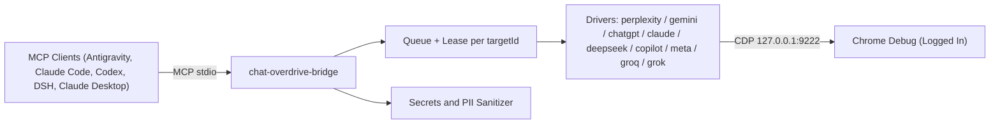

# ARCHITECTURE — chat-overdrive-bridge

Portuguese version: [ARQUITETURA.md](ARQUITETURA.md)

Architecture reference document for the **chat-overdrive-bridge** project.
Origin: internal project plan (design phase).

## 1. Overview

**chat-overdrive-bridge** is an MCP (Model Context Protocol) server with `stdio` transport, developed in Node.js, designed to let MCP clients (Antigravity IDE, Claude Code, OpenAI Codex, DeepSeek Harness — DSH, Claude Desktop, Cursor, Windsurf) query frontier models in already authenticated web interfaces (Perplexity, Gemini, ChatGPT, Claude, DeepSeek, Copilot, Meta AI, Groq, Grok) through the Chrome DevTools Protocol (CDP) connected to a local debugging browser instance (`127.0.0.1:9222`).

The architecture avoids unnecessary local HTTP servers, auxiliary WebSockets on ports 8989/4545, network tunnels and MV3 browser extensions, ensuring a minimal attack surface and full control over the data in transit.

## 2. Main Components

### 2.1 MCP Server (stdio)
- Implemented using the official `@modelcontextprotocol/sdk` library.
- Communication strictly via standard input and output (`stdio`), with no opening of inbound network ports.
- Broad multi-client compatibility: Antigravity IDE, Claude Code (CLI and IDE), OpenAI Codex (`~/.codex/config.toml`), DeepSeek Harness — DSH (`cordis.patch.yml`), Claude Desktop, Cursor, and Windsurf.
- Exposes 15 structured tools supporting provider-specific direct dispatch across 9 web providers, parallel comparison, and native multimodal image delivery under the MCP protocol.

### 2.2 CDP Layer (Chrome DevTools Protocol)
- Connection established via `playwright-core` using the method `chromium.connectOverCDP('http://127.0.0.1:9222')`.
- Strict network restriction: exclusively local loopback `127.0.0.1`.
- Tab management based on leases associated with the CDP `targetId`, preventing disorderly concurrency over the same tab.
- Access to the internal `Runtime.evaluate` API kept strictly encapsulated within the internal drivers; it is never exposed as an MCP tool.

### 2.3 Concurrency and Scheduling
- **Between distinct providers (Perplexity, Gemini, ChatGPT, Claude, DeepSeek, Copilot, Meta AI, Groq, Grok):** concurrent/parallel execution allowed (e.g., a request to Perplexity and another to Gemini may run simultaneously).
- **Within the same provider:** strictly serial execution with an in-memory queue, guaranteeing an exclusive tab lease and an interval with jitter to avoid anti-bot triggers and rate blocks.

### 2.4 Secrets and PII Sanitizer
- Mandatory interceptor executed before any text is sent to the browser.
- Set of regex patterns (`_SECRET_PATTERNS`) to intercept:
  - API keys (OpenAI, Google, AWS, JWT tokens, GitHub, etc.).
  - Certificates and private keys (`.pem`, `.key`, `.pkcs12`).
  - Database credentials, connection strings and `.sql` dumps.
  - Sensitive configuration files and snippets (`.env*`, `*_privado*`, `*.jsonl`).
  - Personally identifiable information (PII) and student information.
- On detection of secrets or PII: the request is immediately blocked with the error `BLOCKED_BY_POLICY`, or sanitized according to the security policy.

## 3. Driver Contract

Each web provider (Perplexity, Gemini, ChatGPT, Claude, DeepSeek, Copilot, Meta AI, Groq, Grok) implements a standardized driver interface:

- `ensureTab(context, targetUrl)`: locates or creates the tab corresponding to the provider.
- `isLoggedIn(page)`: evaluates whether the user's session is active and usable.
- `newChat(page)`: starts a new clean topic/conversation.
- `setMode(page, mode)`: adjusts search mode, focus or model according to the provider's support.
- `send(page, text)`: focuses the input box and injects the text (e.g., via `Input.insertText` for Lexical editors).
- `waitDone(page, timeoutMs)`: waits for the response to complete by monitoring the disappearance of the "Stop" buttons and DOM stabilization via MutationObserver (debounce of 400 to 600 ms).
- `extractAnswer(page)`: extracts the generated text, citations and structured references/sources.
- `extractImages(page)`: extracts images generated by the model in the current turn via DOM / canvas with WebP-to-PNG conversion support.
- `stop(page)`: immediately interrupts the ongoing generation in the interface.
- `diagnose(page)`: runs the self-diagnostic routine for the provider's selectors.

### 3.1 Specialized Driver Behaviors (Groq and Grok)

- **GroqDriver (`chat.groq.com`):**
  - **Arabic Model Prevention:** The driver forces navigation to `https://chat.groq.com/?model=qwen/qwen3.8-27b`, ensuring that the initial model is `qwen/qwen3.8-27b` rather than the default Arabic model loaded by the site root.
  - **Resilient 429 Cascade Rotation:** If Groq signals high load or an HTTP 429 rate limit during processing, the driver automatically performs a cascade rotation among supported models:
    `qwen/qwen3.8-27b` -> `openai/gpt-oss-120b` -> `qwen/qwen3.6-27b` -> `openai/gpt-oss-20b`.
- **GrokDriver (`grok.com`):**
  - **Free-Tier Enforcement:** Operates with active safeguards that restrict interactions strictly to free modes `Fast` and `Build`.
  - **Budget Protection:** Rejects and avoids selecting paid modes (`Auto`, `Expert`, and `Heavy`), shielding users against accidental quota consumption or paid account blocks.

### Selector Strategy (3 Levels)
To ensure resilience against visual updates of web interfaces:
1. **Level 1 (Semantic / Data):** application-specific attributes (e.g., `data-lexical-editor`, `data-workflow-final-text`, `data-renderer`).
2. **Level 2 (Multi-language Aria):** accessibility roles and labels in multiple languages (e.g., `button[aria-label="Enviar"]`, `button[aria-label="Submit"]`).
3. **Level 3 (Structural / SVG):** SVG paths and node structure as the last-resort fallback.

## 4. MCP Tools

The MCP server exposes 15 tools via stdio:

| Tool | Arguments | Return | Description |
|---|---|---|---|
| `ask_perplexity`, `ask_gemini`, `ask_chatgpt`, `ask_claude`, `ask_deepseek`, `ask_copilot`, `ask_meta`, `ask_groq`, `ask_grok` | `prompt` (string), `session` (optional), `new_chat` (optional), `timeout_s` (optional), `attachments` (optional), `context_files` (optional) | `{ text, sources[], images[], provider, model, duration_ms, session }` | Direct, specialized query to the chosen chat, optimized for natural language dispatch. |
| `compare_web_chats` | `prompt` (string), `providers` (optional, array), `timeout_s` (optional) | `{ prompt, results: { [provider]: { text, sources[], images[], duration_ms } } }` | Runs queries across multiple web chats in parallel and returns side-by-side results. |
| `ask_web_chat` | `provider` (string), `prompt` (string), `session` (optional), `new_chat` (optional), `timeout_s` (optional) | `{ text, sources[], images[], provider, model, duration_ms, session }` | Generic query tool specifying the target provider (accepts aliases). |
| `list_chat_sessions` | none | `{ sessions: [{ id, provider, targetId, createdAt }] }` | Lists the sessions and tabs active and managed by the bridge. |
| `cancel_chat` | `session` (string) | `{ success, session }` | Interrupts ongoing generation for the specified session. |
| `chat_bridge_status` | `doctor` (optional, bool) | `{ cdpConnected, cdpPort, providers, progress }` | Returns CDP connection health, queue state, and optional selector diagnostics. |
| `preview_payload` | `provider` (string), `prompt` (string) | `{ allowed, violations[], sanitizedPrompt }` | Dry-run mode for prior validation of compliance against the sanitizer. |

## 5. Structured Error Codes

In case of failure, the bridge returns standardized structured errors:

- `CDP_UNAVAILABLE`: Debug Chrome not found at `127.0.0.1:9222`.
- `AUTH_REQUIRED`: Expired session or login screen requested in the web interface.
- `TAB_BUSY`: Provider or tab busy serving another serial request.
- `PROMPT_TIMEOUT`: Time limit exceeded while waiting for a response from the web interface.
- `CANCELLED`: Operation explicitly cancelled by the user or tool.
- `BLOCKED_BY_POLICY`: Prompt contained secrets, PII or violated the sanitizer's security policy.

## 6. Logging and Telemetry

- Execution logs strictly record operational metadata: provider queried, inferred model, elapsed time in milliseconds, approximate number of characters/tokens and status/error codes.
- It is strictly prohibited to record the text of sent prompts or generated responses in log files or history (`history.jsonl`).
- Periodic rotation of log files, guaranteeing a ceiling of 30 KB / 300 lines / 20 entries per agent log file.

## 7. Testing Strategy

- **Unit Tests and Fixtures:** Fast, independent tests using the native Node.js runner (`node:test`) and syntax checking (`node --check`).
- **HTML Fixtures:** Mocks of pages and real DOM structures recorded locally to validate selector extraction, citations and sanitization without depending on a network connection or on a real open Chrome.
- **Opt-in Integration Tests:** Live tests executed strictly serially, on explicit demand, using test credentials and fictitious data.
