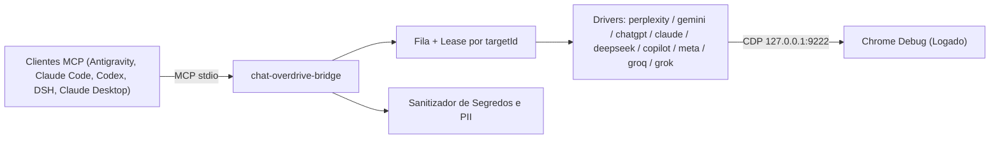

# ARQUITETURA — chat-overdrive-bridge

English version: [ARCHITECTURE.en.md](ARCHITECTURE.en.md)

Documento de referência arquitetural do projeto **chat-overdrive-bridge**.
Origem: plano de projeto interno (fase de concepção).

## 1. Visão Geral

O **chat-overdrive-bridge** é um servidor MCP (Model Context Protocol) com transporte `stdio`, desenvolvido em Node.js, projetado para permitir que clientes MCP (Antigravity IDE, Claude Code, OpenAI Codex, DeepSeek Harness — DSH, Claude Desktop, Cursor, Windsurf) consultem modelos de ponta em interfaces web já autenticadas (Perplexity, Gemini, ChatGPT, Claude, DeepSeek, Copilot, Meta AI, Groq, Grok) através do Chrome DevTools Protocol (CDP) conectado a uma instância de navegador de depuração local (`127.0.0.1:9222`).

A arquitetura elimina servidores HTTP locais desnecessários, WebSockets auxiliares em portas 8989/4545, túneis de rede e extensões de navegador MV3, garantindo superfície de ataque mínima e total controle sobre os dados trafegados.

## 2. Componentes Principais

### 2.1 Servidor MCP (stdio)
- Implementado utilizando a biblioteca oficial `@modelcontextprotocol/sdk`.
- Comunicação estritamente via entrada e saída padrão (`stdio`), sem abertura de portas de rede de entrada.
- Ampla compatibilidade multi-cliente: Antigravity IDE, Claude Code (CLI e IDE), OpenAI Codex (`~/.codex/config.toml`), DeepSeek Harness — DSH (`cordis.patch.yml`), Claude Desktop, Cursor e Windsurf.
- Expõe 15 ferramentas estruturadas com suporte a consultas diretas para 9 provedores web, comparação paralela e entrega de imagens multimodais nativas do protocolo MCP.

### 2.2 Camada CDP (Chrome DevTools Protocol)
- Conexão estabelecida via `playwright-core` utilizando o método `chromium.connectOverCDP('http://127.0.0.1:9222')`.
- Restrição estrita de rede: loopback local `127.0.0.1` exclusivo.
- Gerenciamento de abas baseado em leases associados ao `targetId` do CDP, impedindo concorrência desordenada sobre a mesma aba.
- Acesso à API interna `Runtime.evaluate` mantido estritamente encapsulado nos drivers internos; nunca é exposto como ferramenta MCP.

### 2.3 Concorrência e Escalonamento
- **Entre provedores distintos (Perplexity, Gemini, ChatGPT, Claude, DeepSeek, Copilot, Meta AI, Groq, Grok):** execução concorrente/paralela permitida (ex.: uma requisição para Perplexity e outra para Gemini podem rodar simultaneamente).
- **Dentro do mesmo provedor:** execução estritamente serial com fila em memória, garantindo lease de aba exclusivo e intervalo com jitter para evitar gatilhos anti-bot e bloqueios de taxa.

### 2.4 Sanitizador de Segredos e PII
- Interceptador obrigatório executado antes de qualquer envio de texto ao navegador.
- Conjunto de padrões regex (`_SECRET_PATTERNS`) para interceptar:
  - Chaves de API (OpenAI, Google, AWS, tokens JWT, GitHub, etc.).
  - Certificados e chaves privadas (`.pem`, `.key`, `.pkcs12`).
  - Credenciais de banco de dados, strings de conexão e dumps `.sql`.
  - Arquivos e trechos de configuração sensíveis (`.env*`, `*_privado*`, `*.jsonl`).
  - Dados pessoais identificáveis (PII) e informações de alunos.
- Em caso de detecção de segredos ou PII: a requisição é bloqueada imediatamente com erro `BLOCKED_BY_POLICY` ou sanitizada conforme política de segurança.

## 3. Contrato de Driver

Cada provedor web (Perplexity, Gemini, ChatGPT, Claude, DeepSeek, Copilot, Meta AI, Groq, Grok) implementa uma interface padronizada de driver:

- `ensureTab(context, targetUrl)`: localiza ou cria a aba correspondente ao provedor.
- `isLoggedIn(page)`: avalia se a sessão do usuário está ativa e utilizável.
- `newChat(page)`: inicia um novo tópico/conversa limpo.
- `setMode(page, mode)`: ajusta modo de busca, foco ou modelo conforme suporte do provedor.
- `send(page, text)`: realiza o foco na caixa de entrada e injeta o texto (ex.: via `Input.insertText` para editores Lexical).
- `waitDone(page, timeoutMs)`: aguarda a conclusão da resposta monitorando sumiço de botões de parada ("Stop") e estabilização de DOM via MutationObserver (debounce de 400 a 600 ms).
- `extractAnswer(page)`: extrai o texto gerado, citações e referências/fontes estruturadas.
- `extractImages(page)`: extrai imagens geradas pelo modelo no turno atual via DOM / canvas com suporte a conversão de WebP para PNG.
- `stop(page)`: interrompe imediatamente a geração em andamento na interface.
- `diagnose(page)`: executa rotina de auto-diagnóstico dos seletores do provedor.

### 3.1 Comportamentos Especiais de Drivers (Groq e Grok)

- **GroqDriver (`chat.groq.com`):**
  - **Prevenção de Modelo Árabe:** O driver força a navegação para `https://chat.groq.com/?model=qwen/qwen3.8-27b`, garantindo que o modelo inicial seja sempre o `qwen/qwen3.8-27b` em vez do modelo padrão em língua árabe carregado pela raiz do serviço.
  - **Rotação Resiliente em Cascata (Anti-429):** Se o Groq retornar sobrecarga ou limite de taxa HTTP 429 durante o processamento, o driver aciona automaticamente uma rotação em cascata entre os modelos homologados:
    `qwen/qwen3.8-27b` -> `openai/gpt-oss-120b` -> `qwen/qwen3.6-27b` -> `openai/gpt-oss-20b`.
- **GrokDriver (`grok.com`):**
  - **Garantia de Modos Gratuitos:** Opera com salvaguardas ativas restringindo a interação aos modos gratuitos `Fast` e `Build`.
  - **Proteção Orçamentária e Anti-Bloqueio:** O driver rejeita ou impede a ativação dos modos pagos `Auto`, `Expert` e `Heavy`, blindando o operador contra consumo indevido de cotas pagas da xAI.

### Estratégia de Seletores (3 Níveis)
Para garantir resiliência contra atualizações visuais das interfaces web:
1. **Nível 1 (Semântico / Dados):** atributos específicos de aplicação (ex.: `data-lexical-editor`, `data-workflow-final-text`, `data-renderer`).
2. **Nível 2 (Aria Multi-idioma):** papéis de acessibilidade e labels em múltiplos idiomas (ex.: `button[aria-label="Enviar"]`, `button[aria-label="Submit"]`).
3. **Nível 3 (Estrutural / SVG):** caminhos SVG e estrutura de nós como fallback de última linha.

## 4. Ferramentas (Tools) do MCP

O servidor MCP expõe 15 ferramentas via stdio:

| Ferramenta | Argumentos | Retorno | Descrição |
|---|---|---|---|
| `ask_perplexity`, `ask_gemini`, `ask_chatgpt`, `ask_claude`, `ask_deepseek`, `ask_copilot`, `ask_meta`, `ask_groq`, `ask_grok` | `prompt` (string), `session` (opcional), `new_chat` (opcional), `timeout_s` (opcional), `attachments` (opcional), `context_files` (opcional) | `{ text, sources[], images[], provider, model, duration_ms, session }` | Consulta direta e especializada ao chat selecionado, otimizada para despacho automático por fala natural. |
| `compare_web_chats` | `prompt` (string), `providers` (opcional, array), `timeout_s` (opcional) | `{ prompt, results: { [provider]: { text, sources[], images[], duration_ms } } }` | Dispara consultas paralelas a múltiplos chats web e retorna as respostas comparadas lado a lado. |
| `ask_web_chat` | `provider` (string), `prompt` (string), `session` (opcional), `new_chat` (opcional), `timeout_s` (opcional) | `{ text, sources[], images[], provider, model, duration_ms, session }` | Executa consulta genérica informando o provedor desejado (aceita apelidos). |
| `list_chat_sessions` | nenhum | `{ sessions: [{ id, provider, targetId, createdAt }] }` | Lista as sessões e abas ativas gerenciadas pelo bridge. |
| `cancel_chat` | `session` (string) | `{ success, session }` | Interrompe a geração em andamento para a sessão especificada. |
| `chat_bridge_status` | `doctor` (opcional, bool) | `{ cdpConnected, cdpPort, providers, progress }` | Retorna o status de integridade do CDP, filas e diagnóstico opcional dos seletores. |
| `preview_payload` | `provider` (string), `prompt` (string) | `{ allowed, violations[], sanitizedPrompt }` | Modo dry-run para validação prévia de conformidade contra o sanitizador. |

## 5. Códigos de Erro Estruturados

Em caso de falha, o bridge retorna erros estruturados padronizados:

- `CDP_UNAVAILABLE`: Chrome debug não encontrado na porta `127.0.0.1:9222`.
- `AUTH_REQUIRED`: Sessão expirada ou tela de login solicitada na interface web.
- `TAB_BUSY`: Provedor ou aba ocupada atendendo a outra requisição serial.
- `PROMPT_TIMEOUT`: Tempo limite excedido aguardando resposta da interface web.
- `CANCELLED`: Operação cancelada explicitamente pelo usuário ou ferramenta.
- `BLOCKED_BY_POLICY`: Prompt continha segredos, PII ou violou a política de segurança do sanitizador.

## 6. Registro de Logs e Telemetria

- Os logs de execução gravam estritamente metadados operacionais: provedor consultado, modelo inferido, tempo decorrido em milissegundos, quantidade aproximada de caracteres/tokens e códigos de status/erro.
- É terminantemente proibido registrar textos de prompts enviados ou respostas geradas em arquivos de log ou histórico (`history.jsonl`).
- Rotação periódica de arquivos de log garantindo teto de 30 KB / 300 linhas / 20 entradas por arquivo de log dos agentes.

## 7. Estratégia de Testes

- **Testes de Unidade e Fixtures:** Testes rápidos e independentes utilizando o runner nativo do Node.js (`node:test`) e checagem de sintaxe (`node --check`).
- **Fixtures HTML:** Mocks de páginas e estruturas de DOM reais gravadas localmente para validar a extração de seletores, citações e sanitização sem dependência de conexão de rede ou do Chrome real aberto.
- **Testes de Integração Opt-in:** Testes ao vivo executados de forma estritamente serial, sob demanda explícita, utilizando credenciais de teste e dados fictícios.
